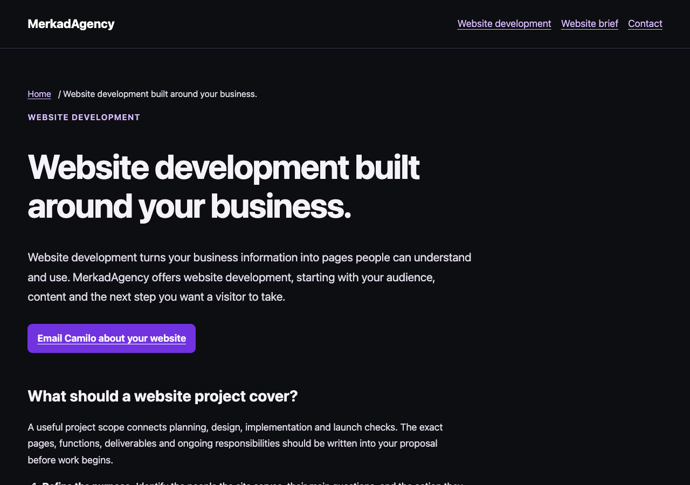

# CAM-257 informational candidate

- [Resolved private-app boundary and live-byte comparison](PRIVATE-BOUNDARY.md)
- [Automated release gates versus manual preconditions](RELEASE-GATES.md)
- [Complete URL/asset retirement and redirect list](URL-PLAN.md)
- [Exact public text and metadata source](../../website/content.mjs)
- [Wording/URL approval sheet, source limitation, Hosting scope and release/rollback proposal](RELEASE.md)
- [Intent map, evidence ownership, editorial/schema and search measurement plan](PLAN.md)
- [Actual acceptance and explicit coverage gaps](ACCEPTANCE.md)
- [Short phone checklist and local preview instructions](PHONE-REVIEW.md)

[Service desktop screenshot](evidence/chromium-service-desktop.png) · [Brief mobile screenshot](evidence/chromium-brief-mobile.png) · [Email-only contact screenshot](evidence/chromium-contact-mobile.png)

Production Hosting, Search Console/indexing and CRM activation are separate outcomes. This candidate is prepared for review; it has not merged or deployed. PR #1 and all its acceptance remain preserved.
